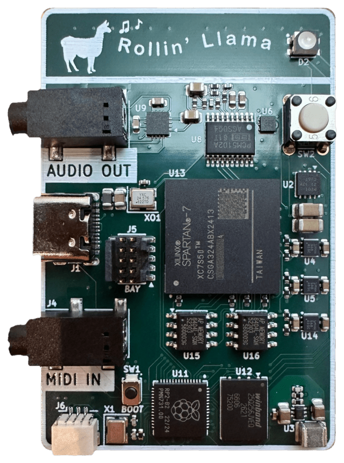
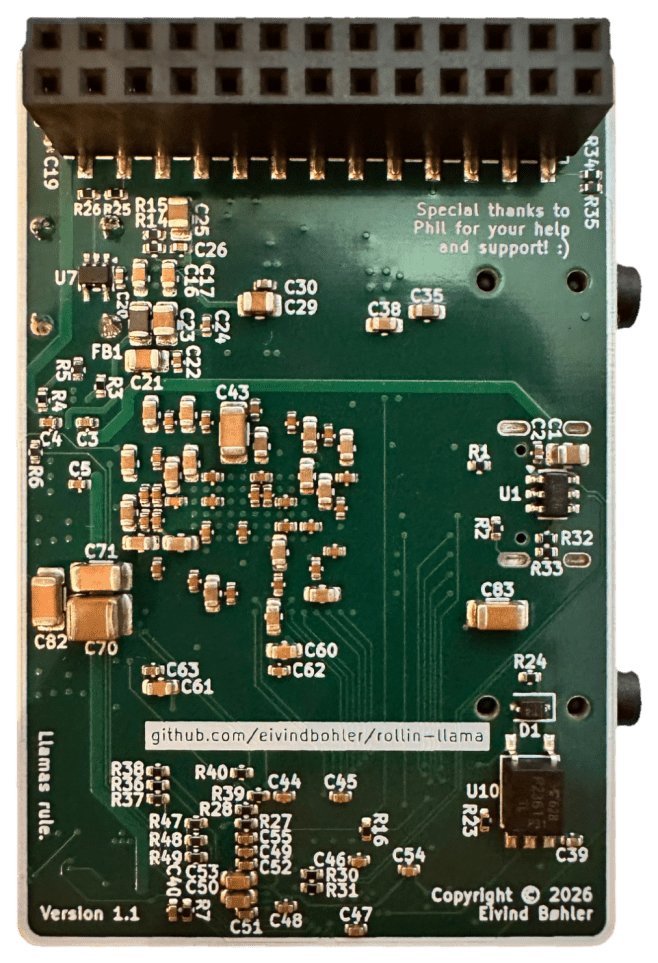

<!-- Two logos, one per GitHub theme. The #gh-*-mode-only fragments are
     matched by GitHub's own stylesheet against the theme chosen in
     Settings > Appearance (a <picture> with prefers-color-scheme follows
     the OS instead, and GitHub does not rewrite it). Renderers without
     that stylesheet show both. -->

  
  

# Rollin' Llama

Rollin' Llama is a wavetable daughterboard for the 2×13 wavetable header
on a 1990s sound card. It also takes MIDI over USB and through a 3.5 mm
MIDI jack, so it works with anything that speaks MIDI, sound card or not.
On board are four selectable *personas*: Roland MT-32, CM-32L, SC-55 mk1
and SC-55 mk2. Each persona runs the original machine's control firmware
on a clean-room HDL model of its hardware inside the FPGA, so what you hear
is the original synth's behavior, not a sample set or an approximation.

The ROMs are not included. You supply control and PCM ROM dumps from your
own units through the web flasher; they never leave your browser.

- [Hardware](#hardware)
- [Personas](#personas)
- [Getting started](#getting-started)
  - [Windows: one-time driver setup](#windows-one-time-driver-setup)
- [Using the board](#using-the-board)
- [DOS utility: ROLLIN.COM](#dos-utility-rollincom)
- [Releases](#releases)
- [Board revisions](#board-revisions)
- [What's in this repository](#whats-in-this-repository)
- [FAQ](#faq)
- [Legal](#legal)

## Hardware

## Personas

| Persona | Model of | Core |
|---|---|---|
| `mt32` | Roland MT-32 (v1.07 firmware) | Intel 8095 (MCS-96) control CPU, LA32 synth, reverb chip |
| `cm32l` | Roland CM-32L (v1.02 firmware) | as the MT-32, with the CM-32L's PCM set |
| `sc55mk1` | Roland SC-55 mk1 (v1.21 firmware) | H8/532 CPU + PCM engine |
| `sc55mk2` | Roland SC-55 mk2 (v1.01 firmware) | H8/532 CPU + PCM engine + sub-MCU |

The LED shows the active persona: blue MT-32, cyan CM-32L, green SC-55
mk1, purple SC-55 mk2. It breathes slowly when idle and lights with each
MIDI message.

## Getting started

Use the **[web flasher](https://eivindbohler.github.io/rollin-llama/)**
(Chrome required: it talks to the board over WebMIDI and WebUSB):

1. Download a firmware release (`.uf2`) from this repo's
   [Releases](../../releases) page.
2. Open the flasher, put the board in BOOTSEL mode, connect.
3. Flash the release, then upload your ROM dumps. They are verified and
   converted entirely in your browser; no ROM data leaves your machine.
4. Optional: the *Volume* section (shown while the board is in normal MIDI
   mode) sets the headphone/line-out level live; the board stores it a few
   seconds after the last change and restores it on power-up.
5. Optional: the *Settings* section switches the board's extra USB interfaces
   (audio capture stream, USB audio) on; both are off until you enable them. Your computer sees each one
   as its own device, so it may ask for permission once per interface. The
   USB audio input is a 48 kHz stereo source, whichever persona is playing.

### Windows: one-time driver setup

macOS and Linux need nothing. Windows does not attach a driver to the
bootloader's PICOBOOT interface on its own, so the flasher can see the board
but not talk to it until you do this once per computer:

- Install [Zadig](https://zadig.akeo.ie/), run it as administrator, tick
  *Options → List All Devices*, choose **RP2 Boot (Interface 1)** (interface
  1, not 0, which is the drive), pick **WinUSB** and install.
- On ARM versions of Windows, Zadig has no driver package to install and will
  fail. Use Device Manager instead: right-click **RP2 Boot**, *Update driver →
  Browse → Let me pick*, choose *Universal Serial Bus devices*, then **WinUsb
  Device**. That attaches the driver but not the device interface GUID an
  application needs, so also run these two lines in an administrator
  PowerShell:

      $d = Get-PnpDevice | Where-Object { $_.InstanceId -like 'USB\VID_2E8A&PID_0003&MI_01*' }
      New-ItemProperty -Path "HKLM:\SYSTEM\CurrentControlSet\Enum\$($d.InstanceId)\Device Parameters" -Name DeviceInterfaceGUIDs -PropertyType MultiString -Value '{86DFF346-1BBA-47A0-B5CA-18CBB02BEF80}' -Force

Then replug the board in BOOTSEL mode and connect again. Flashing firmware by
dragging a `.uf2` onto the RPI-RP2 drive works without any of this; only ROM
uploads and settings go through PICOBOOT.

## Using the board

Switch persona with the button (cycles mt32 → cm32l → sc55mk1 → sc55mk2)
or from DOS with ROLLIN.COM. The board remembers the last persona and the
volume and starts there on the next power-up.

## DOS utility: ROLLIN.COM

`dos/ROLLIN.COM` switches the card's mode and sets its volume from the DOS
machine the card sits in, over the MPU-401 port (default 330, or give the
base in hex as a second argument).

    ROLLIN mt32           select a mode: mt32, cm32l, sc55mk1, sc55mk2
    ROLLIN sc55mk1 300    same, on an MPU-401 at port 300
    ROLLIN /V100          set the headphone/line-out volume, 0..127
                          (127 = full, 0 = mute)

Nothing is echoed back over MIDI, so success shows as the card's LED
changing color (mode) or the level changing (volume). The volume is stored
on the card a few seconds after the last change and comes back on power-up.

## Releases

Each tagged release carries two `.uf2` files. Both hold the RP2040 firmware
and all four FPGA bitstreams, and neither contains any ROM data.

- `rollin-llama-vX.Y.Z.uf2` is the normal update. Your uploaded ROMs and
  your settings are untouched.
- `rollin-llama-vX.Y.Z-full.uf2` rewrites the whole 16 MB flash, for a card
  in an unknown state. Everything else is erased, so the ROMs have to be
  uploaded again afterwards and the USB interface settings go back to off.
  The file is 33.5 MB and takes a few minutes to flash.

Either can be flashed with the web flasher or by dragging it onto the
RPI-RP2 drive in BOOTSEL mode.

## Board revisions

- **Rev 1.0**: 64 Mbit SDRAM, 128 Mbit flash. Runs firmware up to v1.0.x.
- **Rev 1.1**: 2 × 64 Mbit PSRAM, 256 Mbit flash, -2 speed grade FPGA. All
  personas stay resident; firmware v1.1.0 and up.

Firmware images declare the board revision they need; the flasher reads
the board's revision and refuses an image it cannot run, and the firmware
checks the same thing at boot (LED pulses red if it finds a mismatch).

## What's in this repository

- `docs/`: the web flasher (a static page, served by GitHub Pages)
- `dos/ROLLIN.COM`: the DOS utility

The HDL, firmware and board design live in a separate repository.

## FAQ

**Where do I get the ROMs?**

From units you own: dump them yourself. The flasher checks each file you
upload against the reference hash and refuses anything else. If you own
the real units but find it hard to dump the ROMs, they should also be
available for download at archive.org: try searching for "sc 55 rom set"
and "mt 32 rom set".

**Which ROM versions are supported?**

Exactly these, byte for byte. File names do not matter: you pick which
ROM you are uploading, and the file is checked against the expected size
and hash.

| Persona | ROM | Size | SHA-1 |
|---|---|---|---|
| MT-32 v1.07 | Control ROM | 64 KiB | `b083518fffb7f66b03c23b7eb4f868e62dc5a987` |
| | PCM ROM | 512 KiB | `f6b1eebc4b2d200ec6d3d21d51325d5b48c60252` |
| CM-32L v1.02 | Control ROM | 64 KiB | `a439fbb390da38cada95a7cbb1d6ca199cd66ef8` |
| | PCM ROM | 1 MiB | `289cc298ad532b702461bfc738009d9ebe8025ea` |
| SC-55 mk1 v1.21 | ROM 1 (CPU) | 32 KiB | `dd01ec54027751c2f2f2e47bbb7a0bf3d1ca8ae2` |
| | ROM 2 | 256 KiB | `9c17f85e784dc1549ac1f98d457b353393331f6b` |
| | Wave ROM 1 | 1 MiB | `8cc3c0d7ec0993df81d4ca1970e01a4b0d8d3775` |
| | Wave ROM 2 | 1 MiB | `80e6eb130c18c09955551563f78906163c55cc11` |
| | Wave ROM 3 | 1 MiB | `7454b817778179806f3f9d1985b3a2ef67ace76f` |
| SC-55 mk2 v1.01 | ROM 1 (CPU) | 32 KiB | `b91bb1d9dccffe831b7cfde7800a3fe32b2fbda6` |
| | Sub-MCU ROM | 4 KiB | `4d48578d811a762a8e7bfaf18989bcac70ae1ba4` |
| | ROM 2 | 512 KiB | `078cb5feea05e80bb9a1bb857a2163ee434fd053` |
| | Wave ROM 1 | 2 MiB | `96708cb21381c2fd03de4babbf7aea301c7594a6` |
| | Wave ROM 2 | 1 MiB | `4d91cdeaed048d653dbf846a221003c3a3f08279` |

**Does it work without a wavetable header, or outside a PC?**

Yes. USB-C power plus USB-MIDI or the 3.5 mm MIDI in is all it needs; the
wavetable header is just one of the three MIDI inputs.

**My MT-32 or CM-32L persona stays silent.**

Like the originals, they ignore MIDI channel 1. Play on channels 2 to 10.
The SC-55 personas respond on all 16.

**The LED is red.**

The firmware could not start the selected persona: a ROM set is missing or
incomplete, or the image was built for a different board revision. Put the
board in BOOTSEL mode and open the flasher; its ROM section shows what is on
the board. Pressing the button retries with the next persona.

**Can I use it as a USB audio interface?**

Yes, as a 48 kHz stereo input to the computer, whichever persona is
playing. It is off by default; turn it on in the flasher's Settings section.
The bit-exact capture stream is a separate interface for tools, not a sound
device.

**How is this different from a software emulator?**

It is the original control firmware running on hardware models of the
original chips at their native clocks, inside the FPGA. Timing, mixing and
the DAC rate are the synth's own, not an approximation of them.

**Is this based on an existing emulator, or on Roland's designs?**

Neither, but it owes a lot to the emulators. The CPUs (the MT-32's Intel
8095 and the SC-55's Hitachi H8/532) are implemented from their public
documentation. The proprietary Roland chips have no documentation, and
what is known about them comes from the reverse-engineering work behind
[Munt](https://github.com/munt/munt) and
[Nuked-SC55](https://github.com/nukeykt/Nuked-SC55). Those were used the
clean-room way: one party studied their observable behavior and wrote
specifications; a separate party, with no access to that source code or to
Roland's, implemented the HDL from the specifications alone. No Roland
schematics, HDL or firmware source were used anywhere. The only Roland
material in the system is the ROM set you upload, which is why the ROMs
are not included.

**Was AI used in this project?**

Yes. The HDL, firmware and tools were primarily written using Claude Fable
and Opus. The clean-room split described above was implemented using LLMs
too: the specifications were written in one set of sessions, and the HDL
was written in separate sessions that had no access to those sessions, to
the emulator sources, or to anything but the specifications. What the LLMs
wrote was held to the same tests as anything else: simulation against
recorded reference output, bit-exact checks of the audio stream, and
listening and bench measurements on real hardware.

The board design is 100% human work.

**Does it sound exactly like the real hardware?**

Digitally, yes: the synth is the original control firmware running on
models of the original chips, so the sample stream that reaches the DAC is
the one the real unit computes.

What differs is everything after the digital stage. The originals have
output paths from the late 1980s and early 1990s: their DACs are noisier
and roll off towards the top of the band, and some let through mains hum.
The card plays the same samples through a modern DAC, so it is flatter,
quieter and cleaner than the real thing. If you want the original's
"warmth", that is the part you are missing, and it is a matter of taste
whether that is a loss.

**Can I switch persona from a game or a player?**

From DOS, with ROLLIN.COM; otherwise the button. The last choice is
remembered across power cycles.

**Do firmware updates keep my ROMs?**

Yes. The update file leaves the ROM data and the settings alone. Only the
`-full` recovery file wipes them.

**Is there a volume control?**

A digital one in 0.5 dB steps, from the flasher's Volume section or
ROLLIN.COM. The board stores it a few seconds after the last change and
restores it on power-up.

## Legal

Roland, Sound Canvas and GS are trademarks or registered trademarks of
Roland Corporation, and MT-32, CM-32L and SC-55 are Roland product names.
Roland Corporation has no connection with this project. The project
contains no Roland code or data; the ROMs it needs come from hardware you
own.
